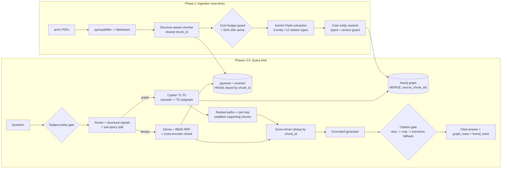

# ArchGraph-RAG: Hybrid Knowledge-Graph + Vector RAG over LLM Architecture Papers (2017–2025)

Built ArchGraph-RAG, a hybrid knowledge-graph + vector RAG system (Neo4j/pgvector, typed entity resolution, parameterized Cypher templates with cascade fallback, per-hop evidence selection, cross-encoder reranking, deterministic citation gate). On a frozen 60-question stress test over a 12-paper offline corpus, it reached **81.7% strict all-hops accuracy vs 63.3% for tuned hybrid vector RAG and 35.0% for plain dense RAG** (p = 0.003 vs tuned hybrid), and **75.0% vs 25.0% on corpus-wide aggregation**, with **100% valid citations**. On a separate 16-question held-out set it scored **81.2% vs 75.0%**. Given the same passage budget, hybrid RAG matches it (83.3%).

> **Read this first.** All numbers come from the **offline** configuration: hand-written synthetic paper text, recorded (not live) LLM graph extraction, a deterministic mock embedder, a rule-based router and an extractive stand-in generator. The 60-question set was **frozen** (unchanged since Phase 5, verified by `git diff` and SHA-256). However, the fixes below were designed by reading its failure diagnostics, so it is now a **development set**. The 16-question **held-out set** was written and frozen *before* any fix and is the fairer estimate of generalization. Live mode (Gemini + Neo4j + pgvector) is wired up but has **not** been run end-to-end.

## Headline: 3-System Benchmark (frozen 60 questions, strict all-hops accuracy)

Strict = the answer is not refused, passes the citation gate (every `[chunk_id]` valid), **and** covers 100% of the question's required concept groups, including any required caveat. Out-of-scope questions pass only if the system abstains. Routes and templates are never graded.

| Stratum (n) | Plain Dense RAG | Tuned Hybrid RAG (RRF + Reranker) | **ArchGraph-RAG** |
|---|---:|---:|---:|
| Single-hop (15) | 40.0% | 93.3% | **93.3%** |
| Two-hop (15) | 40.0% | 66.7% | **80.0%** |
| Three-hop (15) | 20.0% | 46.7% | **66.7%** |
| Aggregation (8) | 0.0% | 25.0% | **75.0%** |
| Out-of-scope (7) | 85.7% | 71.4% | **100.0%** |
| **Multi-hop, 2+3 hop (30)** | 30.0% | 56.7% | **73.3%** |
| **All answerable (53)** | 28.3% | 62.3% | **79.2%** |
| **Overall (60)** | 35.0% | 63.3% | **81.7%** |
| Wilson 95% CI (overall) | [24.2, 47.6] | [50.7, 74.4] | [70.1, 89.4] |

All three systems share the same corpus, embedder, reranker, generator, citation gate and subject-entity gate; only retrieval differs. Each uses `top_k=3`. ArchGraph-RAG takes 3 stratified graph-supporting chunks plus 3 vector chunks (deduplicated, at most 6 passages) and verbalized graph facts. Head-to-head against tuned hybrid RAG: 12 wins, 1 loss (exact paired sign test p = 0.003).

### Before vs after the five architectural fixes (same frozen 60 questions)

| Strict accuracy | Plain Dense before → after | Tuned Hybrid before → after | **ArchGraph-RAG before → after** |
|---|---:|---:|---:|
| Single-hop | 40.0 → 40.0 | 86.7 → 93.3 | 86.7 → **93.3** |
| Two-hop | 40.0 → 40.0 | 66.7 → 66.7 | 66.7 → **80.0** |
| Three-hop | 13.3 → 20.0 | 40.0 → 46.7 | 40.0 → **66.7** |
| Aggregation | 0.0 → 0.0 | 25.0 → 25.0 | 50.0 → **75.0** |
| Out-of-scope | 42.9 → 85.7 | 28.6 → 71.4 | 57.1 → **100.0** |
| All answerable | 26.4 → 28.3 | 58.5 → 62.3 | 62.3 → **79.2** |
| **Overall** | 28.3 → 35.0 | 55.0 → 63.3 | **61.7 → 81.7** |

ArchGraph-RAG newly passes 13 questions (S01, T02, T07, H01, H02, H05, H07, H09, A02, A04, O04, O05, O06) and newly fails 1 (H06). The baselines also improved, because two fixes are shared by every system: the subject-entity gate (out-of-scope) and the score-ranked generator (single- and three-hop).

### Held-out check (16 questions written and frozen before any fix)

| Strict accuracy | Plain Dense before → after | Tuned Hybrid before → after | **ArchGraph-RAG before → after** |
|---|---:|---:|---:|
| All answerable (14) | 35.7 → 35.7 | 78.6 → 78.6 | 85.7 → 85.7 |
| Out-of-scope (2) | 0.0 → 50.0 | 0.0 → 50.0 | 0.0 → 50.0 |
| **Overall (16)** | 31.2 → 37.5 | 68.8 → 75.0 | **75.0 → 81.2** |

**On held-out questions, the fixes changed no answerable result.** The only gain is HO1 ("Claude 3 Opus"), which the new subject gate now refuses, for all three systems. HO2 ("Switch Transformer") is still answered from unrelated chunks, because the gate only recognizes versioned names and a short list of known systems. ArchGraph-RAG's held-out lead over tuned hybrid RAG is 1 question (HT3, p = 1.0). So most of the jump from 61.7% to 81.7% on the 60-question development set should be read as fixes fitted to those 60 questions. The held-out set is too small (14 answerable) to measure generalization precisely.

### Accuracy by stress type (frozen 60)

| Stress type (n) | Plain Dense | Tuned Hybrid | **ArchGraph-RAG** |
|---|---:|---:|---:|
| direct (6) | 50.0% | 83.3% | **100.0%** |
| paraphrased (9) | 33.3% | 77.8% | **88.9%** |
| implicit_bridge (13) | 7.7% | 38.5% | **61.5%** |
| caveat_trap (12) | 41.7% | 75.0% | **83.3%** |
| cross_pillar (13) | 23.1% | 53.8% | **76.9%** |
| out_of_scope (7) | 85.7% | 71.4% | **100.0%** |

| Secondary metric (answerable) | Plain Dense | Tuned Hybrid | **ArchGraph-RAG** |
|---|---:|---:|---:|
| Proportional concept recall | 43.4% | 77.7% | **90.6%** |
| Evidence chunk recall (required chunks in context) | 34.6% | 70.8% | **89.3%** |
| Citation gate validity | 100% | 100% | 100% |
| Citation support precision | 38.6% | **55.7%** | 46.2% |
| False refusal/abstention rate | 3.8% | 0.0% | 0.0% |

### Is the graph advantage just more context? (sensitivity check)

| Strict accuracy | Tuned Hybrid top_k=3 | Tuned Hybrid top_k=6 | ArchGraph-RAG | ArchGraph-RAG, ≤3 passages |
|---|---:|---:|---:|---:|
| Two-hop | 66.7% | **100.0%** | 80.0% | 80.0% |
| Three-hop | 46.7% | **80.0%** | 66.7% | 46.7% |
| Aggregation | 25.0% | 50.0% | **75.0%** | **75.0%** |
| All answerable | 62.3% | **84.9%** | 79.2% | 73.6% |

**Most of ArchGraph-RAG's lead on 2–3 hop questions is passage budget.** Hybrid RAG at `top_k=6` scores 83.3% overall vs 81.7%, with 7 vs 6 discordant questions (p = 1.0). With ArchGraph-RAG capped at 3 passages, its lead over hybrid `top_k=3` falls to 11 vs 3 (p = 0.057). What survives budget matching is **aggregation**: 75.0% with 3 passages vs 25.0–50.0% for hybrid RAG. The verbalized `MITIGATES` / `ADOPTS_COMPONENT` / `EXTENDS` aggregates list every member of an answer set at once, which no single passage does.

### Latency and cost

| System | p50 latency | p95 latency | Projected $/query | One-time ingestion |
|---|---:|---:|---:|---:|
| Plain Dense RAG | 2.27 ms | 4.57 ms | $0.00223 | $0.00104 (embeddings) |
| Tuned Hybrid RAG | 3.22 ms | 5.46 ms | $0.00257 | $0.00104 (embeddings) |
| **ArchGraph-RAG** | 17.95 ms | 46.91 ms | $0.00475 | $0.0236 (embeddings + LLM graph extraction) |

These are in-process offline timings and vary by a few ms between runs; accuracy is deterministic. **The fixes made ArchGraph-RAG about 3x slower than before** (p50 5.6 → 18 ms): it now always runs the vector channel, ranks every path, scores each hop's chunks separately, and cascades templates. Dollar costs are projected from measured prompt token counts at **assumed** rates set in `.env` (router $0.15/$0.60, generation $1.25/$10.00, embedding $0.15 per 1M tokens). ArchGraph-RAG costs about 1.8x per query, plus a one-time extraction pass about 22x the embedding cost. The 70 synthetic chunks are much shorter than real papers.

## The five architectural fixes

| Fix | What changed | Where |
|---|---|---|
| 1. Structural routing | A `VECTOR_ONLY` decision is upgraded to `HYBRID_PARALLEL` when the question contains a bridge phrase ("the predecessor", "first validated in", "started from"…), has 2+ clauses, or names entities with no direct graph edge between them (a possible false premise, such as LLaMA-1 + GQA). Entities that *are* directly linked (Llama 3 + RoPE) stay vector-only. Natural aggregation phrasings ("Across the indexed papers…", "Which models in…", "more than one model family") select T5, with an optional anchor entity (transitive, direction-preserving) and a minimum-sources filter. | `src/retrieval/router.py`, `cypher_templates.py` |
| 2. Vector channel always on + cascade | Every in-scope route also runs `search_hybrid_reranked`. T1–T4 results that are empty or miss a resolved entity cascade into T6 over all resolved entities; an empty T5 cascades into T6. T1 and T3 now traverse `REQUIRES`, `CAUSES_BOTTLENECK` and `ADOPTS_COMPONENT` (T3 up to 3 hops). "Transformer" in an attention context also seeds Multi-Head Attention. | `router.py`, `cypher_templates.py` |
| 3. Per-hop stratified chunks | Paths are ranked by query coverage minus a per-extra-hop cost (25% of the best 1-hop score), so detours don't beat direct answers. Supporting chunks are chosen as the best chunk per hop along the top paths, scored against `question + verbalized hop`, before any global fill. This fixes Phase 3 MH-03 (26/27 → 27/27). | `router.py` |
| 4. Score-ranked generator | The offline generator drops the 2-sentences-per-passage cutoff. It keeps the top path and aggregate facts, then the best text sentence and the best graph fact per question clause, then fills by maximal marginal relevance. Scoring uses stemmed tokens. Shared by all systems. | `src/generation/synthesizer.py` |
| 5. Subject-entity gate | Versioned model names (GPT-4, Gemini 1.5, Mixtral 8x22B, Claude 3) and a short list of known external systems must appear in the indexed corpus text, or the question is refused. It is checked in the router and again in the synthesizer, so it applies to all systems. It never refuses any of the 67 answerable development or held-out questions (unit-tested). | `src/retrieval/subject_gate.py` |

**Tuned parameters to be aware of.** These were chosen while looking at the development set's failures:

| Parameter | Value |
|---|---:|
| Per-hop cost (`HOP_GAIN_FRACTION`) | 0.25 |
| Generator answer budget (`max_items`) | 10 |
| MMR redundancy weight | 0.7 |
| Clause context weight | 0.25 |

## Honest failure notes (ArchGraph-RAG still misses 11 of 60)

| Failure mode | Questions | Why |
|---|---|---|
| A text-only fact never reached the 6-passage context | S10 (2,048-token context), H03 (MQA quality/speed), H11 (60% waste), H12 (RoPE long-term decay), H15 (no architecture change), A08 (Llama 3's six-stage extension) | The missing facts are not graph relations, so no edge carries them. The question's other clauses win the 3 vector slots. Hybrid RAG at `top_k=6` gets several of these, which is the passage-budget effect above. |
| Bridge entity described, not named | T15 ("the predecessor that validated DeepSeek-V3's designs" → DeepSeek-V2's 236B/21B), A06 (LLaMA-13B beating GPT-3) | The graph has the `DeepSeek-V3 EXTENDS DeepSeek-V2` edge, but the parameter counts live only in text, and nothing triggers a second vector query for the bridge entity. A06's "beats" relation was never extracted as an edge. |
| Caveat chunk out-ranked | T03 ("How many KV heads does LLaMA-1 use in its GQA layers?"), T14 | The structural upgrade fires (false-premise signal), but the correcting chunk ("LLaMA uses standard multi-head attention") ranks below GQA-heavy chunks for a GQA-heavy question. |
| Generator dropped context evidence | H06 (newly failing) | The new clause-coverage selection picks a different sentence for "what does the interpolation approach do wrong". |
| Out-of-corpus subject without a version | held-out HO2 ("Switch Transformer") | The gate only catches versioned names and a short list; a known-name registry does not scale. A real fix is an answerability check on the retrieved evidence. |

## Live production mode

```powershell
docker compose up -d neo4j postgres          # Postgres is mapped to host port 5433
# .env: GEMINI_API_KEY=...  (see .env.example)
.\.venv\Scripts\python.exe scripts/ingest_phase1.py --dry-run-budget          # projected extraction + embedding cost
.\.venv\Scripts\python.exe scripts/ingest_phase1.py --seed-only --index-vectors --max-budget-usd 1.00
.\.venv\Scripts\python.exe scripts/play_phase4_rag.py --live -q "Which techniques mitigate the KV cache bottleneck?"
$env:RAG_MODE="live"; .\.venv\Scripts\python.exe -m uvicorn src.api.main:app
```

**Free-tier operation:**
- **Pacing.** A shared `RateLimitGovernor` keeps every live call under per-minute ceilings, using a 60 s sliding window per model. Cache hits never wait.

  | Model | Ceiling (RPM / TPM) | Free-tier limit |
  |---|---|---|
  | `gemini-3.5-flash-lite`, `gemini-3.1-flash-lite` | 13 / 200K | 15 / 250K |
  | `gemma-4-31b-it` | 25 / 13K | 30 / 16K |
  | `gemini-embedding-001` | 80 / 24K | 100 / 30K |
- **Fallback.** A per-minute 429 waits and retries. A daily-quota 429 steps through `FALLBACK_MODEL_1..3`.
- **Resumable exit.** When every model is exhausted, ingestion exits with code 4 and prints a resume banner. Everything finished is already saved: every chunk extraction and embedding is cached in SQLite as it completes, and each paper is committed to Neo4j and pgvector when it finishes.
- **One chunk per extraction call.** Reference lists are stripped before chunking.
- **Seeding.** `--seed-from-fixtures` seeds live Neo4j and pgvector from the 12-paper fixtures, with 0 LLM calls and real Gemini embeddings.
- **Live routing.** Live mode always uses the Gemini agent router. If the router fails, the query gets HTTP 503; it never falls back to the regex router.
- **Telemetry.** Every response carries `usage_telemetry` with exact router and generator tokens from `interaction.usage`, plus estimated embedding tokens and request counts. `play_phase4_rag.py --live` prints it as a "PATH & QUOTA TELEMETRY" report.

- **One ingestion command fills both stores.** `--index-vectors` makes ingestion write the graph to Neo4j and the chunks (with their resolved `entity_ids`) to pgvector. It connects to PostgreSQL *before* extraction, so an unreachable database never wastes extraction spend.
- **What `RagService.live()` connects:** `Neo4jGraphStore`, `PgVectorStore` + `GeminiEmbedder`, `GeminiRouterLLM` and `GeminiGeneratorLLM`. It loads every Neo4j entity into the query-time resolver.
- **Startup check:** it fails with one message listing every unmet dependency (API key, Neo4j, PostgreSQL, empty stores).
- **Verification status:**

  | Check | Status |
  |---|---|
  | Startup check with all three dependencies missing | Run on this machine (no key, Neo4j and Postgres down) |
  | Neo4j Cypher for the expanded T1/T3/T6 templates (bench-namespaced data) | Integration test written; skipped here because Neo4j was not running |
  | PostgreSQL `text_exists` SQL | Checked only against a recording connection |
  | Live Gemini routing and generation | Not run anywhere |

## Architecture



## Reproducibility

```powershell
python -m venv .venv; .\.venv\Scripts\python.exe -m pip install -r requirements.txt

# Phase 5 (offline, deterministic) -> data/benchmark/phase5_results.json (+ before/after vs phase5_results_before.json)
.\.venv\Scripts\python.exe scripts/benchmark_phase5.py
.\.venv\Scripts\python.exe scripts/benchmark_phase5.py --questions data/benchmark/phase5_heldout_questions.json --out data/benchmark/phase5_heldout_results.json

# Earlier phase scorecards (all 100%: 53/53, 21/21, 24/24, 27/27, 21/21)
.\.venv\Scripts\python.exe scripts/benchmark_phase1a.py
.\.venv\Scripts\python.exe scripts/benchmark_phase1b.py
.\.venv\Scripts\python.exe scripts/benchmark_phase2.py
.\.venv\Scripts\python.exe scripts/benchmark_phase3.py
.\.venv\Scripts\python.exe scripts/benchmark_phase4.py

# Tests (Neo4j integration tests run only if Neo4j is reachable)
.\.venv\Scripts\python.exe -m pytest -v

# Frozen-set check
git diff data/benchmark/phase5_eval_questions.json      # must be empty
```

**Key files:**

| What | File |
|---|---|
| Questions (frozen) | `data/benchmark/phase5_eval_questions.json` |
| Held-out questions | `data/benchmark/phase5_heldout_questions.json` |
| Runner and grading | `src/evaluation/benchmark_runner.py` |
| Subject gate | `src/retrieval/subject_gate.py` |
| Offline corpus fixtures | `src/ingestion/offline_fixtures.py` |
