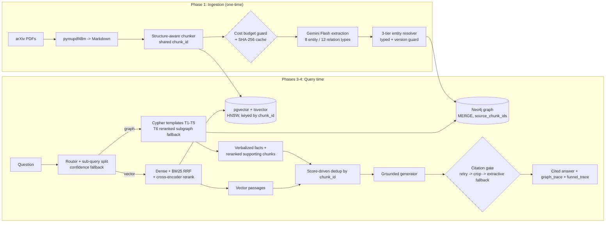

# ArchGraph-RAG: Hybrid Knowledge-Graph + Vector RAG over LLM Architecture Papers (2017–2025)

**Resume line:** Built ArchGraph-RAG, a hybrid knowledge-graph + vector RAG system (Neo4j/pgvector, typed entity resolution, parameterized Cypher templates, cross-encoder reranking, deterministic citation gate). On a 60-question pathway-agnostic stress test over a 12-paper synthetic offline corpus it reached **61.7% strict all-hops accuracy vs 55.0% for tuned hybrid vector RAG and 28.3% for plain dense RAG**, with **50.0% vs 25.0% on corpus-wide aggregation** and **100% valid citations**. The gain over tuned hybrid RAG is **not statistically significant** (p = 0.22, n = 60), and it disappears against hybrid RAG given the same passage budget.

> All numbers below are from the **offline** configuration: hand-written synthetic paper text, recorded (not live) LLM graph extraction, a deterministic mock embedder, a rule-based router and an extractive stand-in generator. They measure the retrieval architecture under controlled conditions, not production quality with Gemini. Reproduce with `scripts/benchmark_phase5.py`.

## Headline: 3-System Benchmark (Strict All-Hops Answer Accuracy)

Strict = the answer is not refused, passes the citation gate (every `[chunk_id]` valid), **and** covers 100% of the question's required concept groups, including any required caveat. Out-of-scope questions pass only if the system abstains. Routes and templates are never graded.

| Stratum (n) | Plain Dense RAG | Tuned Hybrid RAG (RRF + Reranker) | **ArchGraph-RAG** |
|---|---:|---:|---:|
| Single-hop (15) | 40.0% | 86.7% | **86.7%** |
| Two-hop (15) | 40.0% | 66.7% | **66.7%** |
| Three-hop (15) | 13.3% | 40.0% | **40.0%** |
| Aggregation (8) | 0.0% | 25.0% | **50.0%** |
| Out-of-scope (7) | 42.9% | 28.6% | **57.1%** |
| **Multi-hop, 2+3 hop (30)** | 26.7% | 53.3% | **53.3%** |
| **All answerable (53)** | 26.4% | 58.5% | **62.3%** |
| **Overall (60)** | 28.3% | 55.0% | **61.7%** |
| Wilson 95% CI (overall) | [18.5, 40.8] | [42.5, 66.9] | [49.0, 72.9] |

All three systems share the same corpus, embedder, reranker, generator and citation gate. Only retrieval differs. Each uses `top_k=3`; ArchGraph-RAG takes 3 graph-supporting chunks plus 3 vector chunks (deduplicated, at most 6 passages) and verbalized graph facts.

### Accuracy by hop count and stress type

| Stress type (n) | Plain Dense | Tuned Hybrid | **ArchGraph-RAG** |
|---|---:|---:|---:|
| direct (6) | 50.0% | 66.7% | **83.3%** |
| paraphrased (9) | 22.2% | 66.7% | 55.6% |
| implicit_bridge (13) | 7.7% | 38.5% | **46.2%** |
| caveat_trap (12) | 41.7% | 75.0% | 75.0% |
| cross_pillar (13) | 23.1% | 53.8% | **61.5%** |
| out_of_scope (7) | 42.9% | 28.6% | **57.1%** |

| Secondary metric (answerable) | Plain Dense | Tuned Hybrid | **ArchGraph-RAG** |
|---|---:|---:|---:|
| Proportional concept recall | 42.8% | 75.5% | **79.9%** |
| Concept recall, aggregation | 26.0% | 56.5% | **83.3%** |
| Evidence chunk recall (required chunks in context) | 34.6% | 70.8% | **82.2%** |
| Citation gate validity | 100% | 100% | 100% |
| Citation support precision | 39.9% | **56.0%** | 51.7% |

### Is the graph advantage just more context? (sensitivity check)

| Strict accuracy | Tuned Hybrid top_k=3 | Tuned Hybrid top_k=6 | ArchGraph-RAG | ArchGraph-RAG, ≤3 passages |
|---|---:|---:|---:|---:|
| Two-hop | 66.7% | **93.3%** | 66.7% | 66.7% |
| Three-hop | 40.0% | **46.7%** | 40.0% | 33.3% |
| Aggregation | 25.0% | 37.5% | **50.0%** | **50.0%** |
| All answerable | 58.5% | **69.8%** | 62.3% | 60.4% |

**On this corpus, most of ArchGraph-RAG's lead over tuned hybrid RAG on non-aggregation questions comes from reading more passages.** Hybrid RAG at `top_k=6` beats it overall: 65.0% vs 61.7%, with 6 vs 4 discordant questions (p = 0.75). The advantage that survives budget matching is **aggregation**: 50.0% with only 3 passages vs 25.0–37.5% for hybrid RAG.

### Latency and cost

| System | p50 latency | p95 latency | Projected $/query | One-time ingestion |
|---|---:|---:|---:|---:|
| Plain Dense RAG | 1.14 ms | 1.81 ms | $0.00221 | $0.00104 (embeddings) |
| Tuned Hybrid RAG | 2.55 ms | 4.39 ms | $0.00256 | $0.00104 (embeddings) |
| **ArchGraph-RAG** | 5.62 ms | 9.80 ms | $0.00423 | $0.0236 (embeddings + LLM graph extraction) |

These latencies are in-process offline timings (in-memory stores, no network or model calls), and they vary by a few ms between runs; accuracy is deterministic. ArchGraph-RAG is about 2x slower than tuned hybrid RAG here. Dollar costs are projected from measured prompt token counts at **assumed** rates set in `.env` (router $0.15/$0.60, generation $1.25/$10.00, embedding $0.15 per 1M tokens). ArchGraph-RAG costs about 1.7x per query because of the extra router call and larger prompts, plus a one-time extraction pass. The 70 synthetic chunks are much shorter than real papers, so real ingestion will cost proportionally more.

## Honest Failure Notes and Engineering Trade-Offs

**How this benchmark was run.** I wrote the 60 questions after enriching the corpus, froze them, and ran every system. I did not tune the router, templates, retrieval or thresholds afterwards. Two changes were made before the first run, and both apply to every system equally:
1. The offline generator stand-in now reads every passage in its prompt (2 relevant sentences per passage, ≤6 total) and ranks graph facts by relevance, instead of reading only the first 2 passages and first 4 facts.
2. The synthesizer accepts explicit "not enough evidence" abstentions, and returns one when no cited claim survives the citation ladder.

One change came after the first run: an in-scope question whose retrieval returns nothing is now labeled `abstained` instead of `refused`. No score changed. An oracle check confirms all 53 answerable questions can be fully answered from their required chunks (`53/53`).

**Where the aggregation advantage comes from.** ArchGraph-RAG's two aggregation wins over tuned hybrid RAG (A01 "which mechanisms reduce KV-cache memory", A03 "everything DeepSeek-V3 adopts") both came from the T6 subgraph fallback. Its verbalized `MITIGATES` and `ADOPTS_COMPONENT` edges list every member at once, even though no single text passage does. These wins survive the 3-passage cap.

**Where ArchGraph-RAG failed (23 of 60: 20 answerable + 3 out-of-scope):**

| Failure mode | Count | Questions | Why |
|---|---:|---|---|
| Multi-hop question routed `VECTOR_ONLY` with high confidence | 6 | T02, T03, T14, T15, H07, H12 | Detail cues ("how much", "how many", "what does…") give the heuristic router 0.9 confidence, so neither the low-confidence escalation nor the graph runs. ArchGraph-RAG then behaves exactly like tuned hybrid RAG. In T15 the middle hop is only described ("the predecessor that validated DeepSeek-V3's attention and MoE designs"). |
| `GRAPH_ONLY` template could not reach the needed hop, and no vector channel ran to compensate | 4 | H01, H02, H05, T07 | **H01:** the alias scan found only "Transformer", so T1 started at `model_family::transformer` (no EXTENDS edges) and the system abstained; the MLA → GQA → MHA path exists from the right root. **H02:** T3 started at DeepSeek-R1, whose link to DeepSeek-V3 is `REQUIRES`, not one of T3's relation types. **H05:** T2 compared LLaMA with Llama 3, while DeepSeek's 93.3% lies outside that diff. **T07:** no entity was named, the vector-seeded T6 explored only Chinchilla's neighborhood, and graph-only routing skipped vector search. |
| T6 fallback ran, but a required **text-only** fact was in neither the graph nor the top-3 vector passages | 6 | H03, H11, H15, A02, A06, A08 | The missing facts ("earlier systems wasted 60%", "no architecture change", "close to multi-head quality") are not relations, so no edge carries them. For A02 ("components in more than one model family"), the top-2 vector seeds pointed only at DeepSeek, so the GQA and RoPE sharing was never explored. |
| Extractive generator dropped evidence that was in context | 4 | S01, S10, H09, A04 | The stand-in keeps at most 2 sentences per passage, so a third relevant sentence ("…extremely small gradients", "2,048 tokens") was cut. Baselines hit the same limit; a real LLM probably would not. |
| In-domain but out-of-corpus question answered anyway | 3 | O04 (GPT-4), O05 (Mixtral), O06 (Gemini 1.5) | The router refuses only off-domain or injection questions. Nothing checks whether the evidence actually answers the question, so related-but-wrong chunks are summarized. All three systems failed these. |

**Trade-offs worth stating plainly:**
- **Caveat traps are retrieval problems here, not reasoning problems.** ArchGraph-RAG and tuned hybrid RAG both score 75.0%. When the correcting chunk is retrieved, it is quoted; when it isn't (T03: *"How many key-value heads does LLaMA-1 use in its grouped-query attention layers?"*), every system fails. The benchmark doesn't penalize answers that repeat a false premise, only missing corrections.
- **The router is the main bottleneck.** 22 of 60 questions went `VECTOR_ONLY`, and 14 of those passed, behaving exactly like tuned hybrid RAG. The low-confidence escalation (`HYBRID(low-conf):T6`) passed 14/16 when the question named entities, but only 5/14 when it had to vector-seed the subgraph. Only 3 questions were routed to a T1–T5 template (T1, T2, T3), and all 3 failed. T4 and T5 were never selected: aggregation phrasings like "Across the indexed papers…" do not match the router's regex cues. Regex-based template selection does not survive paraphrase. The Gemini router (`GeminiRouterLLM`) is implemented but has not been benchmarked.
- **The graph is only as good as extraction.** Offline, triples are recorded by hand from every relation stated in the fixture text. That is an upper bound on what a live extractor would produce.
- **Extra cost buys aggregation, not general multi-hop.** ArchGraph-RAG costs about 1.7x per query plus about 22x the one-time ingestion cost. On this corpus, that pays off for corpus-wide aggregation and abstention (57.1% vs 28.6% on out-of-scope). A larger `top_k` on hybrid RAG is the cheaper fix for ordinary 2-hop questions.
- **Regression found while enriching the corpus:** Phase 3 multi-hop case MH-03 now fails (26/27), for the same "support budget dropped a required chunk" reason as above.

## Architecture



## Reproducibility

```powershell
# Environment
python -m venv .venv; .\.venv\Scripts\python.exe -m pip install -r requirements.txt

# Phase 5 headline benchmark (offline, deterministic, ~1.5 s) -> data/benchmark/phase5_results.json
.\.venv\Scripts\python.exe scripts/benchmark_phase5.py

# Earlier phase scorecards
.\.venv\Scripts\python.exe scripts/benchmark_phase1a.py   # entity resolution, chunker
.\.venv\Scripts\python.exe scripts/benchmark_phase1b.py   # cache, budget guard, idempotent graph merge
.\.venv\Scripts\python.exe scripts/benchmark_phase2.py    # retrieval ablation
.\.venv\Scripts\python.exe scripts/benchmark_phase3.py    # router + Cypher templates
.\.venv\Scripts\python.exe scripts/benchmark_phase4.py    # citation gate, API traces

# Full test suite (the Neo4j integration test runs only if Neo4j is reachable)
.\.venv\Scripts\python.exe -m pytest -v

# Interactive
.\.venv\Scripts\python.exe scripts/play_phase4_rag.py --query "Trace how Multi-Head Attention evolved through GQA to Multi-head Latent Attention, and give the exact W^{DKV} latent compression equation"
.\.venv\Scripts\python.exe -m uvicorn src.api.main:app --port 8000

# Live services (optional): docker compose up -d neo4j postgres   (Postgres on host port 5433)
```

**Key files:** questions in `data/benchmark/phase5_eval_questions.json`; runner and grading in `src/evaluation/benchmark_runner.py`; offline corpus fixtures and recorded triples in `src/ingestion/offline_fixtures.py`.
