# ArchGraph-RAG: End-to-End Graph & Hybrid Retrieval Flow

> Technical reference for **ArchGraph-RAG** across the **Frontier LLM Systems & Architecture Engineering (2017–2026)** corpus ([corpus_35_papers.yaml](../data/manifest/corpus_35_papers.yaml)). Covers every stage from user question to verified `[chunk_id]` answer, every cross-lane dependency between Vector and Graph retrieval, all Cypher traversal modes, HippoRAG Personalized PageRank, the Bounded 2-Turn Evidence-Gap loop, worked examples, empirical ablations, and known V2 architecture improvements.

---

## 1. Domain Umbrella & Dual-Store Shared-Key Contract

### 1.1 The 5 Interconnected Pillars (2017–2026)

Our corpus covers **35 curated arXiv papers** across **5 tightly coupled layers of the modern LLM stack** where breakthroughs in one pillar directly create bottlenecks (and design drivers) in the next:

1. **Core Transformer Block & Residuals** (`Pre-LN`, `RMSNorm`, `SwiGLU`, `mHC`, `Engram`, `AttnRes`)
2. **Attention & Sparse Compute** (`MHA`, `MQA`, `GQA`, `MLA`, `NSA`, `Gemma 3`, `DSA`, `DeepSeek-V4`)
3. **Scaling, Context & Pre-Training** (`Kaplan`, `RoPE`, `Chinchilla`, `YaRN`, `ProLong`, `DeepSeek-V3`, `Arch Scaling`)
4. **Post-Training & RLVR Reasoning** (`InstructGPT/PPO`, `Constitutional AI/RLAIF`, `DPO`, `PRM`, `GRPO/R1`, `DAPO`, `GSPO`, `OAPL`)
5. **Inference Systems & GPU Kernels** (`PagedAttention`, `AWQ`, `RadixAttention/SGLang`, `FlashAttention-3`, `EAGLE-3`, `FlashAttention-4`)

### 1.2 Shared Deterministic Key (`chunk_id`)

Both databases are joined **without extra translation tables** via one deterministic key generated by [chunker.py](../src/ingestion/chunker.py):

```text
{paper_id}::s{section_idx:02d}::c{chunk_idx:02d}
Example: deepseek_2024_v2::s02::c00
```

* **Graph → Text:** Every relationship edge in Neo4j stores `r.source_chunk_ids` and `r.evidence_quotes`. Once a graph traversal selects paths, `fetch_chunks_by_ids()` pulls the exact source paragraphs from PostgreSQL in one primary-key SQL query.
* **Vector → Graph:** Every chunk row in PostgreSQL `pgvector` stores `entity_ids TEXT[]` (populated by Phase 1 extraction + text mention scanning). When vector search retrieves a chunk, its `entity_ids` immediately serve as **live entry seeds into Neo4j** (`Vector-Seeded Entry` and `Endpoint B` bridging).

### 1.3 Ingestion Pipeline Recap (Why Retrieval Works)

Before a single query runs, [pipeline.py](../src/ingestion/pipeline.py) builds both stores paper-by-paper:

1. **Core-Body Section Filtering:** Converts arXiv PDFs to Markdown (`pymupdf4llm`), keeps display equations (`$$...$$`) and tables atomic, strips trailing noise (`References`, `Acknowledgments`, `Ethics`, `Broader Impact`, `Limitations`, `Appendices`), and caps at `max_chunks_per_paper=18` core chunks (`620` core chunks across the 35 real papers).
2. **Structured LLM Graph Extraction:** Sends **1 chunk per call** to `gemini-3.5-flash-lite` (SQLite-cached by `content_hash`) constrained by Pydantic enums in [ontology.py](../src/schema/ontology.py) (**8 `EntityType`s**, **12 `RelationType`s**) plus a **short 1-sentence verbatim `evidence_quote`** (`~15–30` words, *not* the whole chunk).
3. **3-Tier Entity Resolution + Graph Commit:** Normalizes aliases while enforcing version/precision and contrastive guards ([entity_resolver.py](../src/ingestion/entity_resolver.py)), then `MERGE`s nodes, aggregated edges, and `MENTIONED_IN` / `IN_PAPER` links into Neo4j.
4. **Batched Embedding + Mention Tagging:** Embeds each paper's chunks in **1 batch call** (`gemini-embedding-001`, 768-dim) and upserts text, vectors (`HNSW`), lexical `tsvector`s, and resolved `entity_ids` into PostgreSQL `pgvector`.

---

## 2. Master Architecture & All Runtime Branches

### 2.1 True Runtime Execution Order (Cross-Lane Interconnectivity)

Unlike naive dual-branch diagrams that draw Graph and Vector as isolated parallel tubes, **`GraphVectorEngine.retrieve()` actually runs the Vector Lane FIRST** so its top hits supply **Endpoint B** seeds and **Vector-Seeded Entry** nodes to the Graph Lane:

```mermaid
flowchart TD
    Q["1. User Question"] --> EL["2. Entity Resolver & Linker (Tier 1 / 2 / 3 + Gated T1·paper)"]

    subgraph RoutePhase["Inside QueryRouter.route (Entity-First Linking -> Router LLM -> Guards)"]
        EL --> LLM["3. GeminiRouterLLM: Intent, Route, Split Subqueries + LLM Template Assignment"]
        LLM --> SG{"Safety, Structural & Slot Guards"}
        SG -->|Router LLM / Unindexed Subject Gate| OOS["Pattern 6: Refusal Short-Circuit (0 DB / 0 Gen Calls)"]
        SG -->|Conf < 0.78 or Multi-Clause / Bridge / Disconnected Entities| HYB["Upgrade VECTOR_ONLY -> HYBRID_PARALLEL"]
        SG -->|High Conf Single Lookup| VECMODE["Pattern 5: Keep VECTOR_ONLY Route"]
        HYB --> TVAL{"Validate LLM Template & graph.has_entity()"}
        TVAL -->|Valid| TREADY["template_assigned_by = 'llm'"]
        TVAL -->|None or Invalid| TFALL["_select_template() / Vector-Seeded T6 Fallback"]
    end

    TFALL --> VS{"0 Concept Entities OR Aggregating?"}
    TREADY --> VLANE
    VS -->|Yes: Borrow Seeds| VLANE

    subgraph VectorLane["4a-4d. Vector + Lexical Channel (Runs FIRST in retrieve)"]
        VLANE["pgvector Queries using vector_subquery"] --> DENSE["4a. Dense HNSW (top 20)"]
        VLANE --> BM25["4b. BM25 tsvector (top 20)"]
        DENSE --> RRF["4c. Reciprocal Rank Fusion (k=60 -> top 15)"]
        BM25 --> RRF
        RRF --> CE["4d. Stage-2 Cross-Encoder Reranker (top 3)"]
    end

    CE -.->|"0-Entity / Agg Seeds (top_k=2 or 5)"| T6SEED["Vector-Seeded T6 Entry"]
    CE -.->|"Endpoint B: Top-2 Chunk Entities"| BRIDGE
    CE -.->|"Endpoint B: Top-3 Chunk Entities"| PPR

    subgraph GraphLane["3a-3d. Cypher, Bridging, HippoRAG PPR, Diverse Selection & Chunk Fetch"]
        T6SEED --> GRAPHRUN["3a. Execute Cypher Template T1-T6 (Neo4j + $params)"]
        GRAPHRUN --> WEAK{"Empty or Missed Question Entity?"}
        WEAK -->|Yes| T6CAS["Cascade into T6 Dynamic Subgraph"]
        WEAK -->|No / After T6| T5CHK{"Template == T5 Aggregation?"}
        T6CAS --> T5CHK
        T5CHK -->|Yes: Floor Short-Circuit| RANK
        T5CHK -->|No| BRIDGE["3b. Goal-Directed Endpoint Bridging (T4 1..3 hops)"]
        BRIDGE --> PPR["3c. HippoRAG PPR Heatmap (alpha=0.85, top-6 nodes, top-5 paths)"]
        PPR --> RANK["3d-i. Greedy Diversity-Aware Top-3 Selection (top-15 pool)"]
        RANK --> CHUNKS3C["3d-ii. pgvector fetch_chunks_by_ids + Per-Hop Rerank (graph_chunk_fetch)"]
    end

    CE --> GAP{"4.5 Evidence-Gap Coverage Gate (Turn 1 < max_turns=2)"}
    CHUNKS3C --> GAP
    GAP -->|"Missing Clause / Entity / Symbol / Bridge"| PASS2["Turn 2: 1x pgvector Search + 1x PPR Expansion -> Merge"]
    GAP -->|Pass 1 Sufficient| CTX
    PASS2 --> CTX

    subgraph Synthesis["5-6. Score-Driven Context Merge & 6-Rung Citation Gate"]
        CTX["5. Normalize [0,1] + Deduplicate by chunk_id (+0.05 Tie-Breaker, max 6 passages)"] --> GEN["6a. Gemini Generator + Neutral Context Prompt"]
        GEN --> GATE{"6b. Citation Gate Ladder (Generate -> Validate -> Repair -> Crop -> Fallback -> Deliver)"}
        GATE -->|Valid + Paragraph Attribution| OK["PASS"]
        GATE -->|Invalid / Uncited| REP["Repair (1 Retry) -> Crop -> Extractive Fallback -> Abstain"]
    end
```



### 2.2 All 6 Execution Branches at a Glance

```mermaid
flowchart LR
    Q["Query"] --> B1{"Unindexed Model or OOS?"}
    B1 -->|Yes| OUT1["Branch 1: Fast Refusal (0 retrieval, 0 gen)"]
    B1 -->|No| B2{"High Conf Detail Lookup, No Structural Signals?"}
    B2 -->|Yes| OUT2["Branch 2: VECTOR_ONLY (4a-4d -> Gap Check -> 5 -> 6)"]
    B2 -->|No| B3{"Cypher Template == T5 Aggregation?"}
    B3 -->|Yes| OUT3["Branch 3: T5 Global Edge Scan (Skips Bridging & PPR; cascades T6 if empty)"]
    B3 -->|No| B4{"0 Concept Entities Resolved?"}
    B4 -->|Yes| OUT4["Branch 4: Vector-Seeded T6 (4d tags -> T6 + Bridging + PPR)"]
    B4 -->|No| B5{"Graph Paths Found?"}
    B5 -->|Yes| OUT5["Branch 5: Full Hybrid (T1-T4 + Bridging + PPR + Gap Turn 2 + 4a-4d)"]
    B5 -->|No (0 hops)| OUT6["Branch 6: Vector Floor (4a-4d Passages + Turn 2 Only)"]
```

| Branch | Trigger Condition | Graph Work Executed | Vector Work Executed | Max Turn-2 Loops |
| :--- | :--- | :--- | :--- | :---: |
| **1. `OUT_OF_SCOPE` Refusal** | Non-domain query or `unverified_subjects()` hit (`GPT-4`, `Claude 3`, etc.) | None | Subject text check only | `0` |
| **2. `VECTOR_ONLY`** | `conf >= 0.78`, `VECTOR_ONLY`, zero structural bridge/clause signals | None (`template = None`) | Full Stage 1–2 (`4a–4d`) | `0–1` |
| **3. `T5` Corpus Aggregation** | `CORPUS_AGGREGATION` + mapped relation word | `T5` scan + optional anchor/year/min-sources (`T6` if empty) | Always-on (`top_k=3`, also seeds `T6` if fallback hits) | `0–1` |
| **4. Vector-Seeded `T6`** | Graph/Hybrid route with **0 resolved non-paper entities** | Borrows `entity_ids` from `4d` (`top_k=2`) → `T6` + Bridging + PPR | Full (`4a–4d`) | `0–1` |
| **5. Full Multi-Hop (`T1–T4`)** | Graph/Hybrid with 1+ verified concept entities | `T1`–`T4` (+ `T6` if weak) + Bridging + PPR + Path Ranker + `3c` | Full (`4a–4d`) | `0–1` |
| **6. Ultimate Vector Floor** | `3b` finds 0 graph paths (even after `T6` + Bridging + PPR) | `0` chunks returned (`supporting_chunks = []`) | Full (`4a–4d`) handles answer cleanly | `0–1` |

---

## 3. Block-by-Block Technical Walkthrough

### Block `1`: User Query

Raw user string (`3–2000` chars) enters `GraphVectorEngine.retrieve()` via FastAPI `POST /query` ([main.py](../src/api/main.py)). No transformations happen here; Block `2` (`Entity Resolver & Linker`) runs next before the Agent Router.

---

### Block `2`: 3-Tier Entity Resolver & Linker ([router.py](../src/retrieval/router.py) + [entity_resolver.py](../src/ingestion/entity_resolver.py))

In `QueryRouter.route()`, **Entity Resolution executes BEFORE the Agent Router LLM** (`entity_resolution.latency_ms`), mapping raw question phrases to verified Neo4j nodes (`graph.has_entity(id) == True`) and disambiguating same-name multi-type entities (e.g., `arch_component::transformer` [`ArchComponent`] vs `model_family::transformer` [`ModelFamily`]) via explicit `entity_type` metadata:

1. **Tier 1 — Exact Alias Scan (`0` API calls):** Scans the raw question against `EntityResolver`'s normalized alias index (`"MLA"` → `arch_component::multi_head_latent_attention`). Orders IDs left-to-right by first appearance (`first_pos`), and adds `arch_component::multi_head_attention` when `"transformer"` appears in an attention context.
2. **Tier 1 Gated Paper Expansion (`T1·paper`):** Detects paper titles (e.g., *"Attention Is All You Need"*) and links `paper::vaswani_2017_transformer`. **Trade-off & Gating Rule:** `paper::* -> INTRODUCES` expansion ONLY fires when `< 1` concrete non-paper entity was resolved from the question (paper-focused queries such as *"What was proposed in Attention Is All You Need?"*). When concrete concepts already resolved (e.g. `Post-LN`, `Pre-LN`, `RMSNorm`), ONLY the `paper::*` node is linked, preventing 7+ unrelated introduced concepts (`Scaled Dot-Product Attention`, `Positional Encoding`, etc.) from polluting `resolved_entity_ids` and downstream Cypher templates.
3. **Tier 2 — Fuzzy Lexical Match (`T2`, `0` API calls):** Extracts candidate noun phrases (`extract_query_phrases()`, max 8 phrases, 6 tokens each) and matches normalized word overlap against Neo4j entity names (`"pre normalization transformer"` → `arch_component::pre_ln`).
4. **Tier 3 — Semantic Embedding Match (`T3`, 1 batched embed call in live mode):** Embeds remaining multi-word technical phrases (`gemini-embedding-001`) in a single batch and cosine-matches against Neo4j entity node descriptions with strict threshold **`>= 0.78`** (disabled automatically on `DeterministicMockEmbedder`).
5. **Post-LLM Extra Entity Check:** Any extra `out.extracted_entities` emitted by the router LLM that were missed initially are also resolved cleanly before template slot validation.

*(Mandatory guards on Tiers 2 & 3 — `has_version_conflict`, dense scale vs MoE grid, and `is_contrastive_sibling` — prevent false merges across model versions or architectural opposites.)*

---

### Block `3`: Agent Router & Subject Gate ([router.py](../src/retrieval/router.py))

The traffic controller inside `QueryRouter.route()`. Receives the pre-resolved candidate entities (`[{entity_id, canonical_name, entity_type}]`) and runs **1 structured JSON call** via `GeminiRouterLLM.classify()` (`gemini-3.5-flash-lite`, zero heuristic fallback in live mode) followed by **3 deterministic safety checks**:

1. **LLM Output Contract (`RouterLLMOutput`):**
   * `query_intent`: One of `SINGLE_FACT_DEFINITION`, `LINEAGE_MULTI_HOP`, `MODEL_OR_COMPONENT_COMPARISON`, `BOTTLENECK_TRACE`, `CORPUS_AGGREGATION`, `UNSTRUCTURED_GRAPH_EXPLORATION`, `UNSUPPORTED_DOMAIN`.
   * `route`: `VECTOR_ONLY`, `GRAPH_ONLY`, `HYBRID_PARALLEL`, or `OUT_OF_SCOPE`.
   * `confidence`: `[0.0, 1.0]`.
   * `standalone_query`, `graph_subquery`, `vector_subquery`, `extracted_entities`, `metadata_filters`.
   * `cypher_template_id` (`T1`–`T6` or `null`) & `template_params`: Live Gemini selects the template and slots using **only** the exact `entity_id` strings passed in `RESOLVED_ENTITIES`.
2. **Deterministic Validation & Fallback (`template_assigned_by`):**
   * **Template + Entity Validation:** Any LLM-assigned `(cypher_template_id, template_params)` must pass `validate_params()` AND verify every bound `entity_id` exists in `self.graph.has_entity(...)` (`template_assigned_by = "llm"`).
   * **Heuristic Fallback:** When offline (`cypher_template_id=None`) or if LLM slots fail validation, `_select_template()` deterministically selects `T1`–`T5` (or Vector-Seeded `T6`), recording `template_assigned_by = "heuristic_fallback"` (`"none"` for `VECTOR_ONLY` / `OUT_OF_SCOPE`).
3. **3 Deterministic Guardrails:**
   * **Unindexed Subject Gate ([subject_gate.py](../src/retrieval/subject_gate.py)):** Tracks `refused_at` (`"router_llm"` vs `"subject_gate"`) and `unverified_subjects` (e.g. `GPT-4`, `Gemini 1.5`). If any extracted model fails `vector_store.text_exists()`, overrides route to `OUT_OF_SCOPE` immediately.
   * **Confidence Floor (`CONFIDENCE_FLOOR = 0.78`):** Upgrades `< 0.78` confidence to `HYBRID_PARALLEL` (`confidence_upgrade = True`).
   * **Structural Upgrade (`structural_signals()`):** Forces `VECTOR_ONLY → HYBRID_PARALLEL` on implicit bridge cues, multi-clause questions, or disconnected entity components via Union-Find.

#### Complete Reference: Parameterized Cypher Templates (`T1`–`T6`)

| ID | Template Name | How Start Nodes Are Chosen from `resolved_entity_ids` | Traversal Direction & Allowed Edges | Hop Depth & Cap | Post-Processing Inside Template |
| :--- | :--- | :--- | :--- | :--- | :--- |
| **`T1`** | `COMPONENT_LINEAGE` | First entity matching `(arch_component::, inference_technique::, training_method::)`, else `ids[0]` → `$root_entity_id` | **Undirected** (`-[...*1..3]-`) over 9 semantic rels (excludes `INTRODUCES`, `IN_PAPER`, `MENTIONED_IN`, `CITES_INSPIRED_BY`) | `1..3` hops, `ORDER BY length(p), x.entity_id`, `LIMIT 50` | None inside `T1` (ranked in `3d`; cascades to `T6` if empty or misses a named entity) |
| **`T2`** | `MODEL_ARCHITECTURE_DIFF` | First 2 `model_family::*` entities (else first 2 IDs) → `$model_a_id`, optional `$model_b_id` | **Directed outgoing** (`-[r]->`) over 8 semantic rels (`T2_RELS`) | `1` hop outgoing, `LIMIT 50` | Computes `_diff()` (`shared`, `only_a`, `only_b`) in Python |
| **`T3`** | `BOTTLENECK_SOLVERS` | First `bottleneck::*` entity, else `ids[0]` → `$bottleneck_id` | **Undirected** (`-[...*1..3]-`) over `MITIGATES`, `CAUSES_BOTTLENECK`, `ADOPTS_COMPONENT`, `REQUIRES`, `EXTENDS` (`T3_MAX_HOPS = 3` in code) | `1..3` hops, `LIMIT 50` | Cascades to `T6` if empty or misses a named entity |
| **`T4`** | `BRIDGE_PATH_2_TO_3_HOP` | **First** entity (`ids[0]`) → `$entity_a_id` and **last** entity (`ids[-1]`) → `$entity_b_id` | **Undirected** `allShortestPaths((a)-[*1..3]-(b))` excluding `IN_PAPER`, `MENTIONED_IN` | `1..3` shortest hops, `LIMIT 50` (direct) / `LIMIT 10` (per bridging pair) | Cascades to `T6` if empty or misses an intermediate entity |
| **`T5`** | `CORPUS_AGGREGATION` | Global relation scan by bound `$relation_type` (+ optional `$category`, `$min_year`); if **exact 1** non-paper entity, sets `anchor_entity_id` | **Directed outgoing** (`(s)-[r]->(t)` where `type(r) = $relation_type`) | `1` hop global scan (`limit=200`, max `500`) | Python `_filter_aggregation()` enforces transitive anchor reachability & `min_sources >= 2`; computes `_aggregate()` counts |
| **`T6`** | `DYNAMIC_SUBGRAPH_FALLBACK` | Full batch of resolved non-paper entities (capped at `20` seeds), OR vector-chunk `entity_ids` if `0` resolved | **Undirected** (`-[*1..2]-`) excluding `IN_PAPER`, `MENTIONED_IN` | `1..2` hops, `LIMIT 50` | **Built-in `_rerank_hops()`:** unpacks edges, scores each `verbalize_hop(h)` vs query, locks in **top 2 per non-paper seed**, caps at `max(8, seeds * 2)` |

*(All entity IDs, filters, and `$limit` values travel strictly as Neo4j `$params`; raw LLM output never touches Cypher syntax.)*

---

### Blocks `4a–4d`: Vector + Lexical Lane (Runs BEFORE `3b` at Runtime)

In `GraphVectorEngine.retrieve()` ([router.py](../src/retrieval/router.py#L866-L868)), the Vector Channel **always executes on every in-scope query** (even `GRAPH_ONLY`) and runs **before** `3b`:

* **`4a` Dense Vector Search:** Embeds `vector_subquery` via `gemini-embedding-001` (`SQLite`-cached) and queries PostgreSQL `pgvector` HNSW index (`top 20`, filtered by `metadata_filters`).
* **`4b` BM25 Lexical Search:** Queries PostgreSQL `tsvector` GIN index (`ts_rank_cd`, `top 20`) to catch exact acronyms, hyperparameters, and math tokens (`W^{DKV}`, `2.788M`, `93.3%`).
* **`4c` Hybrid RRF Fusion:** Merges Dense and BM25 rankings via Reciprocal Rank Fusion (`rrf_k = 60`), emitting the top `15` candidates (`candidate_k = 15`). *(Unweighted RRF alone suffers from intra-domain cosine crowding in uniform ML corpora, so Stage 2 reranking is essential.)*
* **`4d` Stage-2 Cross-Encoder Rerank:** Default in live mode (`RagService.live()`) is **`GeminiApiReranker`** ([reranker.py](../src/stores/reranker.py#L287-L412)), which scores all `15` passages jointly against `vector_subquery` in **1 batched structured JSON call** (`[0.0, 1.0]`), returning top `k = 3` (`vector_chunks`). *(Offline CI uses deterministic `TokenInteractionReranker` weighting `[Paper: Title]` at `0.20x` vs `Section + Body` at `1.0x` so titles like `"Attention Is All You Need"` cannot flood top-3 hits; optional local CPU `OnnxCrossEncoderReranker` is also available.)*

> **Cross-Lane Output (`4d → 3b`):** The top-2 chunks from `4d` expose their stored `entity_ids` to Block `3b` as **Endpoint B** for Goal-Directed Endpoint Bridging (and top-3 chunks for HippoRAG PPR).

---

### Block `3b`: Multi-Strategy Graph Traversal, Bridging, PPR & Path Ranking

For every template except **`T5` (Aggregation)**, Block `3b` merges **3 complementary graph signals** into one unified `result.paths` pool before ranking:

#### `3b-i`. Primary Cypher Template + `T6` Weak Cascade

Runs the selected template (`T1`–`T6`) against Neo4j (`limit=50`).
* **Why `T6` cascade exists:** Templates `T1`–`T4` execute **1 single query** (e.g., `T1` starts from only 1 root node; `T4` bridges only `ids[0]` ↔ `ids[-1]`). `_is_weak()` checks if `result.paths` is empty OR failed to cover *any* non-paper entity in `resolved_entity_ids`. If so, it runs `T6` over all resolved seeds and appends up to `max(8, seeds * 2)` seed-stratified edges.

#### `3b-ii`. Goal-Directed Endpoint Bridging (`_bridge_to_vector_endpoints`)

**Why bridge if the template already succeeded?** Because `T1`–`T4` only traverse between entities the user *explicitly named*. If the user implied an unnamed target (*"...and which DeepSeek model was trained with GRPO without SFT?"* — never naming `DeepSeek-R1-Zero`), or if `T1` fanned out blindly in 15 directions from 1 hub node, **Endpoint B** from Vector Search (`4d`) acts as a GPS destination pin.

* **Exact Pairing & Deduplication Example:**
  Suppose your question resolves **Endpoint A = `[A, B, C]`** and top-2 vector chunks carry **Vector Entities = `[A, D, E]`**:
  1. Overlapping `A` is excluded from Endpoint B ([router.py](../src/retrieval/router.py#L743-L752)), leaving **Endpoint B = `[D, E]`**.
  2. Bridging fires `T4` (`1..3` hop `allShortestPaths`, `LIMIT 10` per pair to cap tied shortest paths) on **`3 × 2 = 6` pairs**: `(A,D), (A,E), (B,D), (B,E), (C,D), (C,E)` — *not* `(B,A)` or `(C,A)`.
  3. **Hard Cap:** Sliced at **`endpoints_a[:3]` × `endpoints_b[:4]` = at most `12` pairs**. Any path signature already discovered in `3b-i` is deduplicated.
  4. **If unreachable within 3 hops:** `T4` returns `0` paths for that pair cleanly without failing; longer/indirect connections are picked up next by HippoRAG PPR.

#### `3b-iii`. HippoRAG Personalized PageRank ([ppr.py](../src/retrieval/ppr.py))

**What PPR is NOT:** It is *not* a depth-first backtracking search that returns `False` if A and B don't meet.

**What PPR actually is:** A **single fast sparse linear-algebra pass** (`nx.pagerank`, ~2 ms in memory over `graph.export_graph(include_chunks=False)`, cached across queries while node/edge counts match) that distributes "relevance mass" across the entire semantic graph simultaneously:

1. **Edge Weighting Policy:**
   * Plumbing edges (`IN_PAPER`, `MENTIONED_IN`) = **Excluded (`0.0`)** (otherwise any two unrelated concepts in a long paper look 2 hops apart).
   * `INTRODUCES` (`Paper → Concept`) = **`0.35`** (dampens paper-level hub shortcuts).
   * All 10 architectural edges (`EXTENDS`, `REPLACES_IN`, `MITIGATES`, `CAUSES_BOTTLENECK`, `ADOPTS_COMPONENT`, `REQUIRES`, `OUTPERFORMS_ON`, `MODIFIES_HYPERPARAMETER`, `EVALUATED_ON`, `CITES_INSPIRED_BY`) = **`1.0` forward**, **`0.75` reverse**.
2. **Simultaneous Bi-Endpoint Personalization (`alpha = 0.85`):**
   Seeds **ALL** Endpoint A concepts at weight **`1.0`** and **ALL** Endpoint B concepts (from top-3 vector chunks, excluding Endpoint A) at weight **`0.6`** (`paper::*` nodes excluded unless zero concept seeds exist). Every step transfers 85% of a node's rank along weighted edges and teleports 15% back to the seed set.
3. **Concrete 5-Node Mechanics Example:**

```text
  Seed A (1.0): DeepSeek-V3 ──(1.0)──► MLA ──(1.0)──► KV Cache ◄── Seed B (0.6)
                     │                                     ▲
                  (0.35)                                (1.0)
                     ▼                                     │
                 Paper_V3 ──(0.35)──► FP8          PagedAttention
```

* **`MLA`** sits directly between `Seed A` (`1.0`) and `Seed B` (`0.6`) and catches probability flowing from **both endpoints** → spikes to the highest non-seed node score.
* **Giant noisy hubs** (`Paper_V3` or `Transformer`) suffer automatic `1/N` fan-out dilution (mass divided across 20–40 neighbors) plus the `0.35` `INTRODUCES` damper.
* **Dead-end nodes** (`FP8`) decay toward zero.
4. **Edge & 2-Hop Bridge Extraction (`retrieve_paths`):**
   Takes the top `top_nodes = 12` active nodes (+ seeds) and scores each edge `(u, rel, v)` by `weight * sqrt(score(u) * score(v))`, forms 1-hop and 2-hop bridge candidates (`1.25×` bonus if the 2-hop path connects an Endpoint A node to an Endpoint B node, `1.15×` if both ends are seeds), reserves balanced slots for 2-hop bridges + 1-hop edges, and merges the top **`5`** unique paths into `result.paths`.

> **Design Note — No Louvain Community Detection:** Corpus-level community summaries were explicitly excluded because multi-document summarization blurs exact architectural formulas, precision qualifiers (`FP8` vs `BF16`), and per-hop `[chunk_id]` provenance. HippoRAG PPR + Cypher `T5` provide global/associative reach at the exact triple level instead.

#### Funnel Math on a Large Query (`4 User Entities + 5 Vector Entities`)

| Stage Inside Block `3b` | Execution Mechanics & Hard Cap | Theoretical Ceiling | Typical Unique Paths | Max Hops |
| :--- | :--- | :---: | :---: | :---: |
| **`3b-i` Primary Template** | `1` Cypher query (`T1`–`T4`, `LIMIT 50`) | `50` | `5–20` | `3` |
| **`3b-i` Weak `T6` Cascade** | Fires only if weak; `max(8, 4 seeds × 2)` | `8` | `0–8` | `1` *(stratified edges)* |
| **`3b-ii` Endpoint Bridging** | `3` Endpoint A × `4` Endpoint B = `12` pairs × `LIMIT 10` (`T4`) | `120` | `2–15` | `3` |
| **`3b-iii` HippoRAG PPR** | `1` pass over all `4 + 5 = 9` seeds (`top_k = 5`, `max_hops = 2`) | `5` | `1–5` | `2` |
| **Combined Pool (Deduped)** | Merged by exact edge-sequence signature | `183` | **`15–45`** | **`1–3`** |

#### `3d`. Path Verbalizer, Diversity-Aware Top-3 Selection & Per-Hop Chunk Fetch

* **Retrieval-Time Path Text (`cypher_templates.verbalize_hop`):**
  For scoring inside `_rank_paths()`, every hop becomes:
  `"{source_name} {relation_in_lowercase} {target_name}. {evidence_quotes}"`
  joined by spaces along the path. Because `evidence_quotes` is a concise 1-sentence claim (not a 450-token chunk), ranking `~15–45` paths takes **`~1–7 ms` on CPU (`0` LLM calls)** via `TokenInteractionReranker`.
* **Length-Normalized Base Score + Greedy Diversity-Aware Top-3 Selection (`enable_diverse_path_selection=True`):**
  1. Scores every candidate path by $\text{score}(\text{path}) = \text{raw\_score}(\text{query}, \text{verbalized\_path}) - 0.25 \times \max(\text{one\_hop\_scores}) \times (\text{len}(\text{path}) - 1)$, sorts descending, and slices the top-15 pool.
  2. Greedily selects up to `3` paths maximizing:
     $$\text{norm\_base\_score} + 0.25 \cdot \text{uncovered\_resolved\_entity\_ratio} + 0.15 \cdot \text{uncovered\_clause\_term\_ratio} - 0.30 \cdot \max\text{EdgeJaccard} - 0.20 \cdot \max\text{ChunkJaccard}$$
     placing the selected top-3 first followed by remaining candidates (`pipeline_trace["path_selection"]`).
* **`pgvector` Chunk Fetch & Per-Hop Stratified Selection (`graph_chunk_fetch`):**
  Slices strictly to the **Top `3` paths (`result.paths[:max_paths=3]`)**, fetches their `source_chunk_ids` from PostgreSQL in 1 batch (`fetch_chunks_by_ids`), measures exact fetch + per-hop rerank latency (`graph_chunk_fetch.latency_ms`), selects the best-proving chunk per distinct hop (`question + verbalize_hop(h)`), and backfills up to `graph_top_k = 3`.

---

### Hidden Step `4.5`: Bounded 2-Turn Evidence-Gap Refinement ([evidence_gap.py](../src/retrieval/evidence_gap.py))

Before assembling the final LLM context, `EvidenceGapRefiner` inspects Pass-1 evidence (`vector_chunks + supporting_chunks`) for structural incompleteness—**hard-capped at `HARD_MAX_TURNS = 2`** (at most **1** Pass-2 loop, zero retries for `OUT_OF_SCOPE`):

* **4 Automated Gap Triggers:**
  1. **Missing Symbol / Equation:** Verbatim math tokens (`W^{DKV}`, `\sqrt{d_k}`) or `"equation"`/`"formula"` asks absent from Pass-1 chunks.
  2. **Missing Explicit Entity:** An entity explicitly named in the question never appeared in Pass-1 chunk text or `entity_ids`.
  3. **Unexplored Discovered Bridge:** A cue like `"predecessor"`/`"checkpoint"`/`"distilled"` + a model entity mentioned once in passing inside Pass-1 text whose spec wasn't retrieved.
  4. **Missing Clause / Quantitative Ask:** A compound sub-clause (ignoring generic graph framing words like `"trace"`, `"lineage"`, `"evolution"`) or `"how many/much/long"` question lacks coverage in Pass-1 text.
* **Pass-2 Execution (only if `has_gap == True`):**
  Runs **1 focused `pgvector` hybrid search** on `gap_query` (filtering out Pass-1 IDs, merging scores via `0.9 × pass1_scale`) **plus 1 PPR pass** seeded with `gap_seed_entities` and backfills any newly surfaced `supporting_chunks` before advancing to Block `5`.

---

### Block `5`: Score-Deduplicated LLM Context ([synthesizer.py](../src/generation/synthesizer.py#L105-L145))

1. **Score Normalization:** Vector (`GeminiApiReranker` scores already in `[0, 1]`) and Graph (`TokenInteractionReranker`, min-max normalized to `[0, 1]` via dividing by list max) are placed on a comparable `[0, 1]` scale.
2. **Deduplication & Bounded Tie-Breaker:** Merges by `chunk_id`. A passage appearing in **both** Graph and Vector lanes (`origin = "both"`) receives only `CORROBORATION_BONUS = +0.05`, ensuring dual retrieval breaks ties without ever overriding a genuinely higher-scoring specialist chunk. **Zero biasing `[HIGH-PRIORITY]` badges** are emitted.
3. **Passages & Neutral Prompt Assembly (`max_passages = 6`):** Strips PyMuPDF4LLM OCR comments (`<!-- ... -->`, `<br>`), builds `=== GRAPH-DERIVED FACTS & LINEAGE PATHS ===` (via `verbalizer.py`: direction-aware `Multi-hop path (N hops): ...`, passive inversion when walking against an edge arrow, per-hop quoted evidence, and `Corpus aggregate:` bullets — every line carrying inline `[chunk_id]` tags) followed by `=== RETRIEVED TEXT PASSAGES ===`.
4. **Strict Citation Whitelist (`allowed_chunk_ids`):** Exact union of `<= 6` passage chunk IDs + graph fact chunk IDs + `template_result.source_chunk_ids`.

---

### Block `6`: Gemini Generator + 6-Rung Citation Gate Ladder ([citation_validator.py](../src/generation/citation_validator.py), [main.py](../src/api/main.py))

1. **Instant Gatekeeper:** If Block `3` or `synthesizer.py`'s re-run of `unverified_subjects()` triggers `OUT_OF_SCOPE`, returns immediate refusal (`0` generator calls; `pipeline_trace.flow_pattern` = `Pattern 6/6 REFUSAL_SHORT_CIRCUIT`). If `allowed_chunk_ids` is empty, abstains cleanly (`INSUFFICIENT_TEXT`).
2. **Primary Generation:** Calls `GeminiGeneratorLLM` (`gemini-3.5-flash-lite`, or UI-selected model) enforcing exact `[chunk_id]` citations on every substantive claim (and permitting honest partial-evidence answers with explicit caveats).
3. **6-Rung Structured Citation Gate Ladder (`pipeline_trace["citation_gate"]["rungs"]`):**
   * **`generate`:** Primary synthesis call (skipped on refusal or empty context).
   * **`validate` (Rung 1 + Tweak A Forward Attribution):** Zero invented IDs, every cited ID resolves in PostgreSQL, zero uncited claims (`>= 4` alpha words outside citations; adjacent setup sentences inherit the following valid `[chunk_id]` when zero invented/unresolved IDs exist).
   * **`repair` (Rung 2, `max_repairs = 1`):** Feeds exact sentence errors + `ALLOWED CHUNK IDS` back to Gemini for **1 repair attempt**.
   * **`crop` (Rung 3a):** If still invalid, drops only offending sentences (`crop_invalid_sentences`) if `>= 1` valid claim survives.
   * **`fallback` (Rung 3b):** If 0 valid sentences survive cropping, builds a safe extractive bulleted answer directly from cited graph facts + top passage sentence (`extractive_fallback`).
   * **`deliver` (Rung 4):** Emits `Deliver` (`PASS` / `REPAIRED_PASS` / `CROPPED` / `EXTRACTIVE_FALLBACK`), `Abstained` (`INSUFFICIENT_TEXT`), or `Refused` (`REFUSED`).

---

## 4. Complete End-to-End Worked Examples

### Example 1: Compound Question + Goal-Directed Endpoint Bridging + PPR

> **Query:** *"Which bottleneck connects PPO and GRPO, and which DeepSeek model was trained with GRPO without supervised fine-tuning?"*

1. **Router (`2`) & Entity Linker (`3a`):** Gemini classifies `LINEAGE_MULTI_HOP`, `HYBRID_PARALLEL` (`conf = 0.91`), splits `graph_subquery` (*"Which bottleneck connects PPO and GRPO?"*) and `vector_subquery` (*"Which DeepSeek model trained with GRPO without supervised fine-tuning?"*). Tier-1 Alias links **`training_method::ppo`** and **`training_method::grpo`** (`"DeepSeek"` alone is intentionally not guessed). Keyword `"connects"` + 2 entities selects **`T4_BRIDGE_PATH_2_TO_3_HOP`** (`ppo ↔ grpo`).
2. **Vector Lane FIRST (`4a–4d`):** HNSW + BM25 + RRF + `GeminiApiReranker` returns `deepseek_2025_r1::s02::c00` tagged with `["model_family::deepseek_r1_zero", "training_method::grpo", "bottleneck::critic_model_memory_overhead"]`.
3. **Graph Traversal (`3b`):**
   * `T4(ppo, grpo)` discovers `PPO -[CAUSES_BOTTLENECK]-> Critic Model Memory Overhead <-[MITIGATES]- GRPO`.
   * **Endpoint Bridging (`A=[ppo, grpo]`, `B=[deepseek_r1_zero, critic_model_memory_overhead]`):** Fires `T4(grpo ↔ deepseek_r1_zero)`, pulling the explicit edge connecting **`GRPO`** directly to **`DeepSeek-R1-Zero`** even though `"R1-Zero"` was never typed!
   * **HippoRAG PPR:** Reinforces `Critic Model Memory Overhead` and `DeepSeek-R1-Zero` from both ends.
4. **Stratified Chunks (`3c`) → Context (`5`) → Gate (`6`):** Locks in chunks proving `PPO` critic overhead, `GRPO` critic removal, and `DeepSeek-R1-Zero` pure RL → **`PASS`**, `100%` grounded `[chunk_id]` citations.

### Example 2: Gated Paper-Title Linking + Contrastive Guards + Title Down-Weighting

> **Query:** *"How did the post-norm layer of Attention Is All You Need evolve into the pre-norm layer and LLaMA's Pre-RMSNorm, and why did Post-LN need a learning-rate warm-up?"*

1. **Entity Linker (`Block 2`):**
   * Tier 1/2 resolves concrete concepts `arch_component::post_ln`, `arch_component::pre_ln`, `model_family::llama_1`, `arch_component::pre_rmsnorm` — Contrastive Sibling Guard prevents `"pre-norm"` from blurring into `"post-norm"`.
   * `T1·paper` resolves `"Attention Is All You Need"` → `paper::vaswani_2017_transformer`. Because `>= 1` concrete concept entities already resolved, **`INTRODUCES` expansion is gated off** so unrelated concepts (`Scaled Dot-Product Attention`, `Positional Encoding`, etc.) are NOT dumped into `resolved_entity_ids` (for paper-only queries with `0` concept hits, `T1·paper` expands `INTRODUCES` normally).
2. **Why `0.20×` Paper-Title Weighting Matters (`4d` & `3d`):** Naively weighting `[Paper: Attention Is All You Need]` at `1.0x` caused the 2017 Transformer paper to flood all top-3 vector chunks for `"why did Post-LN need a learning-rate warm-up?"` — even though the mathematical explanation lives in Xiong et al. (2020) `[xiong_2020_preln::s01::c00]`! Down-weighting the paper-title segment (`0.20×`) while keeping `Section: ...` + body at `1.0×` lets the `Pre-LN` gradient chunk win cleanly.
3. **Graph Chain (`3a–3d`):** Seed-stratified `T1` + Bridging + PPR resolves `Transformer -[ADOPTS_COMPONENT]-> Post-LN <-[REPLACES_IN]- Pre-LN <-[EXTENDS]- Pre-RMSNorm <-[ADOPTS_COMPONENT]- LLaMA-1`.

### Example 3: Zero Entities Resolved → Vector-Seeded `T6` + Turn-2 Evidence-Gap Loop

> **Query:** *"The rotary extension method that needs 10x fewer tokens improves on which interpolation approach, which model family did it stretch to 128k tokens, and does it alter the architecture?"*

1. **Entity Linker (`3a`):** User never names `"YaRN"`, `"Position Interpolation"`, or `"LLaMA-2"` → **0 explicit concept entities resolve**.
2. **Vector-Seeded Entry (`4d → 3a/3b`):** `search_hybrid_reranked(top_k=2)` returns `peng_2023_yarn` chunks tagged with `["arch_component::yarn", "arch_component::position_interpolation", "model_family::llama_2"]`, setting `vector_seeded=True` and firing `T6`.
3. **Pass-2 Evidence-Gap Loop (`4.5`):** Pass-1 covers YaRN, `10x fewer tokens`, and `Position Interpolation`, **but misses the final yes/no clause** (`"and does it alter the architecture?"`). `EvidenceGapRefiner` detects the uncovered clause, synthesizes `gap_query="yarn alter architecture"`, runs **Turn 2** `pgvector` search + PPR, and pulls **`peng_2023_yarn::s04::c00`** stating that YaRN requires **no change to the Transformer architecture** (`turns_used=2`).

### Example 4: Guardrails & Edge Cases

* **`4a` — Unindexed Subject Refusal:** *"What context length does Gemini 1.5 Pro support, and which attention variant does it use?"* → `extract_subject_names()` extracts `"Gemini 1.5"`, `vector_store.text_exists("gemini 1.5")` returns `False` → immediate `OUT_OF_SCOPE` refusal (`0` Neo4j hops, `0` vector top-k calls, `0` generator calls, `100%` refusal accuracy).
* **`4b` — False-Premise Caveat Trap:** *"How many KV heads does LLaMA-1 use in its GQA layers?"* → Gemini guesses `VECTOR_ONLY`, **but** Union-Find sees `model_family::llama_1` and `arch_component::gqa` have **no direct Neo4j edge** (`2 disconnected groups`), triggering **Structural Upgrade → `HYBRID_PARALLEL`**, surfacing `touvron_2023_llama1` (uses standard MHA) and clarifying the false premise.

---

## 5. Verified Benchmark & Ablation Summary (60 Frozen Questions)

Evaluated on the frozen 60-question Phase 5 stress test ([phase5_eval_questions.json](../data/benchmark/phase5_eval_questions.json); offline 12-paper synthetic corpus, shared generator/citation gate/refusal gate across all systems; `run_id` verified `208/208` passing tests):

| System Variant | Single-Hop (`15`) | Two-Hop (`15`) | Three-Hop (`15`) | Aggregation (`8`) | OOS (`7`) | **Overall (`60`)** | Evidence Recall | Claim Faithfulness |
| :--- | :---: | :---: | :---: | :---: | :---: | :---: | :---: | :---: |
| **Plain Dense RAG (`top_k=3`)** | 40.0% | 40.0% | 20.0% | 0.0% | 85.7% | **35.0%** | 34.6% | 100.0% |
| **Tuned Hybrid RAG (`top_k=3`)** | **93.3%** | 80.0% | 33.3% | 12.5% | 71.4% | **61.7%** | 70.4% | 100.0% |
| **Budget Control: ArchGraph (`<= 3` passages)** | **93.3%** | 86.7% | 60.0% | **62.5%** | **100.0%** | **80.0%** | — | 95.4% |
| **Ablation: S3 (`PPR OFF, 2-Turn OFF`)** | **93.3%** | 93.3% | 46.7% | **62.5%** | **100.0%** | **78.3%** | — | 96.5% |
| **Ablation: S3 (`PPR ON, 2-Turn OFF`)** | **93.3%** | 93.3% | 53.3% | **62.5%** | **100.0%** | **80.0%** | — | 96.1% |
| **Ablation: S3 (`PPR OFF, 2-Turn ON`)** | **93.3%** | **100.0%** | 60.0% | **62.5%** | **100.0%** | **83.3%** | — | 97.0% |
| **Full ArchGraph-RAG (`<= 6` passages)** | **93.3%** | **100.0%** | **73.3%** | **62.5%** | **100.0%** | **86.7%** | **93.7%** | **96.8%** |

* **Head-to-Head Significance (Paired McNemar vs Tuned Hybrid `k=3`):** **15 wins, 0 losses (`p = 0.000`)**. On `implicit_bridge` questions, ArchGraph scores **`84.6%` vs `38.5%`**; on `cross_pillar`, **`69.2%` vs `46.2%`**.
* **Latency & Cost Trade-Off:** Offline p50/p95 latency is `47.6ms / 80.0ms` (vs `6.25ms / 9.65ms` Tuned Hybrid) and projected token cost is ~1.9x per query plus the one-time extraction pass. For simple 1-hop FAQ workloads, Tuned Hybrid suffices; ArchGraph justifies its budget specifically on multi-hop bridges, cross-pillar lineage, and global aggregations.
* **Live Generalization Note:** After ingesting all 35 real arXiv PDFs (`620` core chunks) into Neo4j + `pgvector`, a live real-PDF benchmark will validate performance beyond these 12 offline synthetic fixtures.

---

## 6. Implemented V2 Architecture Upgrades & Future V3 Roadmap

### Implemented V2 Upgrades

1. **Entity-First Routing & Validated LLM Template Assignment ([router.py](../src/retrieval/router.py)):**
   * `QueryRouter.route()` runs Tier-1 alias scan, paper mention lookup, and Tier 1/2/3 `link_entities()` **before** `llm.classify()`, passing disambiguated `{entity_id, canonical_name, entity_type}` candidates into `GeminiRouterLLM`.
   * Live Gemini assigns `cypher_template_id` (`T1`–`T6` or `null`) and slot `template_params` using only those exact `entity_id`s, validated deterministically via `validate_params()` + `graph.has_entity()`, with clean fallback to `_select_template()` (`template_assigned_by`: `"llm"` | `"heuristic_fallback"` | `"none"`).
2. **Paper-Title `INTRODUCES` Expansion Gating (`T1·paper`):**
   * `paper::* -> INTRODUCES` concept expansion now fires **only** when `< 1` concrete non-paper entity resolved from the question, eliminating noisy 7+ concept dumps on focused queries while retaining full recall on paper-only queries.
3. **Diversity-Aware Greedy Top-3 Path Selection (`enable_diverse_path_selection=True`):**
   * Upgraded `_rank_paths()` to select top-3 paths greedily from the top-15 pool (`norm_base + 0.25 * uncovered_entity + 0.15 * uncovered_clause_term - 0.30 * edge_jaccard - 0.20 * chunk_jaccard`).
   * **Phase 5 Ablation (`enable_diverse_path_selection` `False` → `True`):**
     * *60-Question Frozen Benchmark:* Strict overall `86.7%` → `86.7%`, Claim Faithfulness `96.8%` → **`97.2%`**, Latency p50 `60.22ms` → **`59.40ms`**, Mean Unique Entities/Top-3 `4.388` → **`4.755` (`+8.4%`)**, Mean Pairwise Edge Jaccard `0.2010` → **`0.1258` (`-37.4%`)**, Mean Pairwise Chunk Jaccard `0.2552` → **`0.1493` (`-41.5%`)**.
     * *16-Question Held-Out Set:* Strict overall `81.2%` → `81.2%`, Claim Faithfulness `97.1%` → `97.1%`, Latency p95 `111.49ms` → **`100.30ms`**, Mean Unique Entities/Top-3 `4.455` → **`4.727` (`+6.1%`)**, Mean Pairwise Edge Jaccard `0.1914` → **`0.1384` (`-27.7%`)**.
     * *50-Paper UI Examples (`5` graph queries):* Mean Unique Edges/Top-3 `3.40` → **`4.00` (`+17.6%`)**, Mean Pairwise Edge Jaccard `0.3611` → **`0.2278` (`-36.9%`)**.
4. **Comprehensive `pipeline_trace` & Dual-Mode Retrieval Flow Instrumentation ([main.py](../src/api/main.py)):**
   * Exposes exact per-stage timings (`entity_resolution`, `routing`, `vector_pass1`, `cypher_template`, `endpoint_bridging`, `hipporag_ppr` with top-6 heatmap nodes, `floor_short_circuit`, `path_selection`, `graph_chunk_fetch`, `evidence_gap`, `context_merge`), `flow_pattern` (`1..6/6`), `resolved_entities`, `unverified_subjects`, and the 6-rung `citation_gate` ladder (`generate -> validate -> repair -> crop -> fallback -> deliver`).

### Remaining V3 Backlog

1. **Intent-Conditioned PPR Edge Weights:** Dynamically weight target edge families by query intent (e.g., `MITIGATES` / `CAUSES_BOTTLENECK` boosted for `BOTTLENECK_TRACE`, `EXTENDS` / `REPLACES_IN` boosted for `LINEAGE_MULTI_HOP`).
2. **Evidence-Based Answerability Gate (Beyond Known-Name Regexes):** Add a post-retrieval answerability check verifying whether retrieved passages + graph facts directly support the primary subject before generation.
