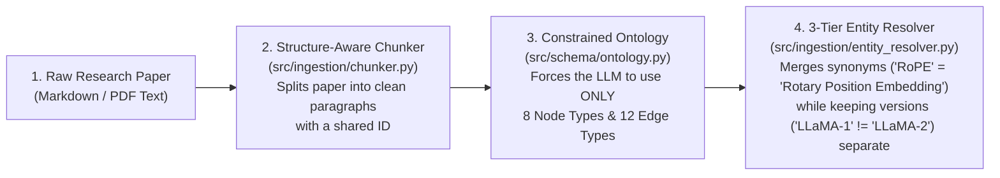

# Phase 1A Engineering, Testing & Evaluation Guide
**A Beginner-Friendly Deep Dive into Ontology Design, Structure-Aware Chunking, Entity Resolution & Scorecard Benchmarking**

---

## Part 1: The Big Picture — What Did We Build in Phase 1A?

Before touching Neo4j or PostgreSQL or spending money on Gemini API calls, **Phase 1A** builds the three guardrails that prevent our Knowledge Graph from turning into an unqueryable hairball:



---

## Part 2: How the Phase 1A Scorecard (`scripts/benchmark_phase1a.py`) Works

Instead of hiding behind unit tests, we now have a **53-case Gold Benchmark** (`data/benchmark/phase1a_gold_cases.json`) and a **Scorecard Runner** (`scripts/benchmark_phase1a.py`) that you can run anytime with one command:

```powershell
.\.venv\Scripts\python.exe scripts/benchmark_phase1a.py
```

### What Does the Scorecard Test Under the Hood?
1. **Order-Independence Check (`A -> B` AND `B -> A`):**
   - `scripts/benchmark_phase1a.py` runs **every pair in both directions** on a fresh resolver. A test case only passes if **both** directions work.
2. **Sequential "State Leak" Detector:**
   - Feeds all 40 pairs into **one single shared resolver** one after another to check if an alias learned in an earlier paper accidentally corrupts a later one.
3. **Computed Root-Cause Hints:**
   - Whenever a test fails, `scripts/benchmark_phase1a.py` inspects the exact internal variables (`extract_version_signature`, `alias_index`, `SequenceMatcher` score) and prints *why* the code made the wrong call.

---

## Part 3: Anatomy of Our Baseline Scorecard (`32 / 53 = 60.4%`)

| Bucket | Baseline Score | Plain-English Meaning of What Failed |
| :--- | :---: | :--- |
| **1. `synonym_merges`** | `17 / 20` (**85.0%**) | Missed 3 merges: `"GPT-3"` vs `"GPT3"` (glued `3`), `"Qwen-2.5"` vs `"Qwen2.5"` (glued `2.5`), and `"Llama-3"` vs `"Llama 3 8B"` (`8B` scale suffix). |
| **2. `adversarial_splits`** | `13 / 20` (**65.0%**) | Falsely merged 7 distinct pairs! Glued numbers (`FlashAttention3`, `INT8` vs `INT4`, `FP16` vs `FP8`), routing `Top-1` vs `Top-K`, parenthetical traps `(ours)` and `(70B)`, and `DeepSeek-R1` vs `DeepSeek-R1-Zero`. |
| **3. `cross_type_edges`** | `0 / 5` (**0.0%**) | Every time a `Paper` introduced a `ModelFamily` or `ArchComponent` with the same name (`DeepSeek-V2`), `global_alias_index` merged them into the same ID and deleted the edge as a self-loop. |
| **4. `chunk_and_mention_cases`**| `2 / 8` (**25.0%**) | Missed `"RoPE."` (period), missed `"Rotary Position Embeddings"` (mid-sentence plural), falsely tagged `LLaMA-1` inside `"Llama 2"`, and flagged `"$2M"` and `"$0.14"` as math equations. |
| **OVERALL SCORE** | **`32 / 53` (60.4%)** | **Macro Average: 43.8%** |

---

## Part 4: The 4 Architectural Trade-Off Decisions

1. **Trade-Off #1 (`DeepSeek-R1` vs `DeepSeek-R1-Zero`):** Keep them **separate** (`SPLIT`) by removing `DeepSeek-R1-Zero` from `DeepSeek-R1`'s alias list in `seed_aliases.yaml` and giving `DeepSeek-R1-Zero` its own node. That way our graph can answer multi-hop questions comparing pure-RL (`R1-Zero`) vs cold-start SFT + RL (`R1`).
2. **Trade-Off #2 (`Llama 3 8B` / `Llama 2 (70B)` vs `Mixtral 8x7B` / `8x22B`):** Strip dense parameter checkpoint suffixes (`7B`, `8B`, `13B`, `70B`, `405B`) into node metadata so they merge into the parent `ModelFamily` (`Llama-3`, `LLaMA-2`), while keeping MoE grid signatures (`8x7B` vs `8x22B`) as distinct versions.
3. **Trade-Off #3 (Future-Proofing Against Tier-3 Embedding Collisions):** Ensure `has_version_conflict` explicitly catches glued version/precision numbers (`Mamba` vs `Mamba2`, `Qwen2` vs `Qwen2.5`, `FP8` vs `FP16`, `INT4` vs `INT8`) even when Tier 3 embedding similarity is turned ON (`embed_fn` returning `1.0`).
4. **Trade-Off #4 (Canonical Name Upgrading on `B -> A` Order):** When a short acronym (`"NSA"`) is seen first and the full name (`"Native Sparse Attention (NSA)"`) is seen second, merge them and upgrade `canonical_name` to the full descriptive form while keeping `"NSA"` in `aliases`.
